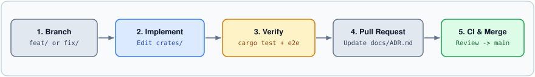

# Contributing to Turf

Contributions are welcome through Pull Requests against `main`. Because `main` is protected, direct pushes are disabled and every change goes through CI and maintainer review. All contributors follow our [Code of Conduct](./CODE_OF_CONDUCT.md) and private [Security Policy](./SECURITY.md).



## Setup & Branching

Prerequisites: Rust stable toolchain (`2021` edition), Git `>= 2.20`, Node.js `>= 20`, and `tmux` (for interactive PTY tests on Linux/macOS/WSL).

```bash
git clone https://github.com/YugSrivastav/Turf.git
cd Turf
git checkout -b feat/your-short-description
```

Use scoped branch prefixes such as `feat/`, `fix/`, `docs/`, `refactor/`, or `test/`. Before editing code, read [AGENTS.md](./AGENTS.md), [ROADMAP.md](./ROADMAP.md), [docs/ARCHITECTURE.md](./docs/ARCHITECTURE.md), and [docs/ADR.md](./docs/ADR.md) (`MD-001` through `MD-056`).

## Where to Make Changes

- [crates/](./crates) : Active Rust CLI (`turf`, `turf-daemon`), TUI cockpit, PTY/VTE engine, encrypted tunnel, and lock/worktree core. Put all shipping CLI fixes and features here.
- [src/](./src) and [bin/](./bin) : Earlier Node.js ESM prototype and test suite. Update only when maintaining legacy behavior or porting features such as [src/agent-runner.js](./src/agent-runner.js) into Rust.

## Verification

Run the checks below before opening a Pull Request:

```bash
# Stop any running background daemon so socket status tests do not race
turf daemon stop || true

# Rust formatting, linting, and workspace tests
cargo fmt --all -- --check
cargo clippy --workspace --all-targets
cargo test --workspace -- --test-threads=1

# Interactive tmux PTY E2E suite (Linux/macOS/WSL)
bash test/e2e-pty.sh

# Legacy Node.js tests
npm ci && npm test
```

## Commits, Docs & Pull Requests

Follow [Conventional Commits](https://www.conventionalcommits.org/) such as `feat(tui): ...`, `fix(daemon): ...`, or `docs: ...`.

- Keep PTY polling and daemon IPC strictly non-blocking inside the 60fps UI loop.
- Preserve multi-file atomic locking (fail fast with zero partial locks) and never write OAuth tokens or API keys to `.turf/` or logs.
- Record new architectural decisions in [docs/ADR.md](./docs/ADR.md) (`[MD-057]` onward) and update [CHANGELOG.md](./CHANGELOG.md) under `[Unreleased]`.
- Push your branch to GitHub and fill out the [Pull Request template](./.github/PULL_REQUEST_TEMPLATE.md). For bugs or proposals, use [Bug Report](./.github/ISSUE_TEMPLATE/bug_report.yml) or [Feature Request](./.github/ISSUE_TEMPLATE/feature_request.yml).
