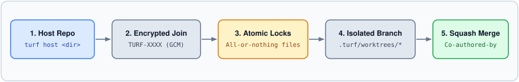

# Turf

Turf turns your terminal into a shared workspace where developers and AI coding CLIs (`codex`, `claude`, `agy`) work inside the same repository without stepping on each other's changes. The active binary (`turf`) is written in Rust, alongside an earlier Node.js ESM prototype ([bin/](./bin), [src/](./src)).

Further reading: [AGENTS.md](./AGENTS.md) for AI coding contributors, [ROADMAP.md](./ROADMAP.md) for current scope and open work, and [docs/ARCHITECTURE.md](./docs/ARCHITECTURE.md) for full system design.

## How It Works



A host shares any local directory with `turf host`, generating a `TURF-XXXX` pairing code over an AES-256-GCM WebSocket tunnel. Tasks declare target files on a shared Intent Board, take all-or-nothing file locks, run inside isolated git worktrees under `.turf/worktrees/`, and squash-merge cleanly back with `Co-authored-by` trailers.

## Architecture


### Crates

- [turf-net](./crates/turf-net) : Interactive launcher (`turf`), repository folder validation (including Windows-to-WSL path translation), room-code pairing, and encrypted P2P WebSocket sync.
- [turf-tui](./crates/turf-tui) : 60fps Ratatui spatial cockpit with full-height split panes, horizontally scrollable tabs, tab context menu (`New tab`, `Rename`, `Close`), pane-bounded clipboard copy, and clickable hyperlinks.
- [turf-daemon](./crates/turf-daemon) : Background session server keeping shells and child processes alive across `F4` / `Alt+D` detaches, re-attaches, and splits.
- [turf-pty](./crates/turf-pty) : Cross-platform PTY allocation (POSIX PTY / Windows ConPTY) and foreground process inspection.
- [turf-vte](./crates/turf-vte) : 2D screen grid and ANSI/TrueColor state machine with alternate-screen isolation, wide-glyph handling, OSC 8 hyperlinks, and a 10,000-line scrollback buffer.
- [turf-core](./crates/turf-core) : Shared Intent Board persistence, atomic multi-file sequence locking, and isolated git worktree management.
- [turf-protocol](./crates/turf-protocol) : Data types and length-prefixed JSON-RPC wire contracts shared across the daemon, tunnel, and cockpit.

More details live in [docs/ADR.md](./docs/ADR.md) (`MD-001` through `MD-056`) and [CHANGELOG.md](./CHANGELOG.md).

## Getting Started

```bash
cargo install --path crates/turf-net
cargo install --path crates/turf-daemon

turf
```

From Windows PowerShell into WSL:

```powershell
wsl turf
```

### Controls

| Input | Action |
| :--- | :--- |
| `Alt+T` / Click `+` | Open a new tab (`+` opens the `new tab` modal) |
| Click active tab / Right-click tab | Open tab menu (`New tab`, `Rename`, `Close`) |
| `Alt+1`..`9` / `Alt+W` | Switch tabs / Close active tab |
| `Alt+V` / `Alt+H` *(or `Alt+S`)* | Split vertically / horizontally |
| `F3` / `Alt+O` / `Alt+X` | Cycle panes / Close active pane |
| `Alt+B` | Toggle sidebar |
| `F2` / `Alt+P` *(or `Alt+Enter`)* | Open centered command modal (`/task`, `/lock`, `/split-h`, `/tab`) |
| `Alt+Up` / `Alt+Down` / Wheel | Scroll history (`Esc` snaps back) |
| Drag / `Ctrl+Shift+C` | Copy text inside active pane (OSC 52 / `clip.exe`) |
| Click URL | Open OSC 8 link or wrapped `https://` URL in browser |
| `F1` / `Alt+?` | Show shortcuts overlay |
| `F4` / `Alt+D` / `Ctrl+Q` | Detach daemon / Quit cockpit |

## Running Tests

```bash
turf daemon stop || true
cargo test --workspace -- --test-threads=1
bash test/e2e-pty.sh
```

For the legacy Node.js suite: `npm ci && npm test`.

## Contributing & License

`main` is protected—open a Pull Request for changes. Read [AGENTS.md](./AGENTS.md), [CONTRIBUTING.md](./CONTRIBUTING.md), [CODE_OF_CONDUCT.md](./CODE_OF_CONDUCT.md), and [SECURITY.md](./SECURITY.md). Licensed under [MIT](./LICENSE).
