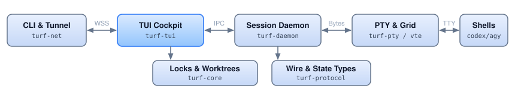

# TurfCode CLI

TurfCode is a real-time multiplayer terminal cockpit and AI coding workspace written in Rust (with an earlier Node.js ESM prototype). Developers host a local repository, pair over an encrypted WebSocket tunnel, run shells and AI coding CLIs (`codex`, `claude`, `agy`) in persistent split panes, and coordinate edits without conflicts using atomic file locks and isolated git worktrees.

For full design context, system vision, and contributor instructions for AI agents, see [AGENTS.md](./AGENTS.md), [ROADMAP.md](./ROADMAP.md), and the [docs/ARCHITECTURE.md](./docs/ARCHITECTURE.md) specification.

TurfCode is organized into modular crates and packages:

- **Native Rust Workspace**: Core terminal multiplexer, background daemon, VTE emulator, locking engine, and encrypted tunnel (`turf` / `turfcode`).
- **Node.js ESM Layer**: Earlier JavaScript CLI and prototype modules ([bin/](./bin), [src/](./src), [test/](./test)).

## Architecture



### Components

- [turf-net](./crates/turf-net) : Provides the interactive launcher (`turf` / `turfcode`), strict local repository path validation (including Windows-to-WSL translation), room-code pairing (`TURF-XXXX`), and the AES-256-GCM encrypted WebSocket tunnel (`TunnelServer` and `TunnelClient`).
- [turf-tui](./crates/turf-tui) : Renders the 60fps Catppuccin spatial cockpit with full-height split panes, horizontally scrollable tabs (`<`, `>`, pinned `+` modal, and `New tab` / `Rename` / `Close` context menu), centered command/help modals, pane-bounded mouse copy, and clickable hyperlinks.
- [turf-daemon](./crates/turf-daemon) : Persistent background server managing named sessions, pane lifecycles, socket/pipe IPC, and parent `cwd` inheritance so running shells and agents survive detaches (`F4` / `Alt+D`).
- [turf-pty](./crates/turf-pty) : Cross-platform PTY allocation (POSIX PTY on Linux/WSL/macOS, ConPTY on Windows) and live foreground process introspection (`/proc` + `tcgetpgrp`).
- [turf-vte](./crates/turf-vte) : Terminal grid and ANSI/TrueColor escape parser supporting DEC alternate screen isolation, wide-glyph handling, OSC 8 hyperlinks, and a 10,000-line scrollback buffer.
- [turf-core](./crates/turf-core) : Manages the shared Intent Board (`IntentBoard`), atomic fail-fast multi-file locking (`LockManager`), and isolated per-task git worktrees with squash-merge (`WorktreeManager`).
- [turf-protocol](./crates/turf-protocol) : Defines shared Intent Board, file lock, `Co-authored-by`, and length-prefixed JSON-RPC daemon IPC contracts.

Additional project documentation lives in [docs/ADR.md](./docs/ADR.md) (architectural invariants `MD-001` through `MD-056`), [CHANGELOG.md](./CHANGELOG.md), and [CONTRIBUTING.md](./CONTRIBUTING.md).

## Getting Started

Prerequisites: **Rust** (stable toolchain, 2021 edition), **Git** (`>= 2.20`), and optionally **Node.js** (`>= 20`) + **tmux** (for PTY E2E tests).

```bash
# Build and install the native `turf`, `turfcode`, and `turf-daemon` binaries
cargo install --path crates/turf-net
cargo install --path crates/turf-daemon

# Launch interactively (Create, Join, or Attach)
turf

# Or host a repository directly
turf host /path/to/repo
```

### Cockpit Controls

| Input | Action |
| :--- | :--- |
| `Alt+T` / Click `+` | Open new tab (`+` opens `new tab` modal; unlimited scrollable tabs) |
| Click active tab / Right-click tab | Open tab menu (`New tab`, `Rename`, `Close`) |
| `Alt+1`..`9` / `Alt+W` | Switch tabs / Close active tab |
| `Alt+V` / `Alt+H` *(or `Alt+S`)* | Vertical / Horizontal pane split |
| `F3` / `Alt+O` / `Alt+X` | Cycle split panes / Close active pane |
| `Alt+B` | Toggle Intent Board sidebar |
| `F2` / `Alt+P` *(or `Alt+Enter`)* | Open centered command modal (`/task`, `/lock`, `/split-h`, `/tab`) |
| `Alt+Up` / `Alt+Down` / Mouse Wheel | Scroll terminal history (`Esc` snaps back) |
| Mouse Drag / `Ctrl+Shift+C` | Pane-bounded text selection and clipboard copy (OSC 52 / `clip.exe`) |
| Mouse Click on URL | Open OSC 8 hyperlink or wrapped `https://` URL in browser |
| `F1` / `Alt+?` | Show shortcuts overlay |
| `F4` / `Alt+D` / `Ctrl+Q` | Detach daemon (keep running) / Quit cockpit |

## Running Tests

```bash
# Rust workspace unit and integration suites
cargo test --workspace -- --test-threads=1

# Interactive tmux PTY end-to-end suite
bash test/e2e-pty.sh

# Node.js prototype tests
npm ci && npm test
```

## Contributing & License

`main` is protected — all changes go through Pull Requests. Read [AGENTS.md](./AGENTS.md), [CONTRIBUTING.md](./CONTRIBUTING.md), [CODE_OF_CONDUCT.md](./CODE_OF_CONDUCT.md), and [SECURITY.md](./SECURITY.md). Released under the [MIT License](./LICENSE).
