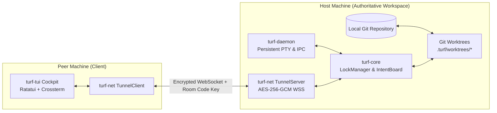
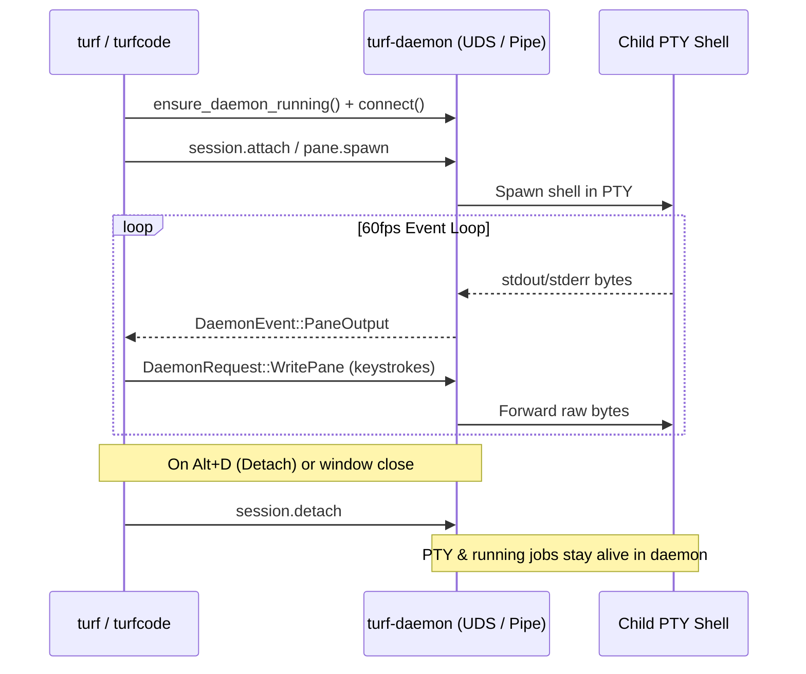

# TurfCode CLI — System Architecture

> **Real-time multiplayer AI coding and terminal multiplexing in your shell.**

This document describes the technical architecture, core subsystems, and design invariants of **TurfCode CLI**. All design decisions and worker invariants are recorded in [docs/ADR.md](./ADR.md).

---

## 1. Problem & Vision

Most terminal environments and AI coding harnesses are strictly single-player. Collaborating on a codebase in real time usually falls back to screen sharing, manual git branch ping-pong, or browser-based editors.

**TurfCode CLI** transforms the native terminal into a multiplayer engineering cockpit:

- **Instant Pairing**: A host starts a session on a local repository (`turf host [dir]`) and receives an unambiguous room code (`TURF-XXXX`). Collaborators join over an encrypted WebSocket tunnel (`turf join <TURF-XXXX>`).
- **Zero-Friction Collaborators**: Peers operate through a lightweight client connected to the host's workspace and lock coordinator—no full toolchain replication required for thin-client workflows.
- **Collision-Free Parallelism**: An **Intent Board** paired with **Atomic Multi-File Sequence Locking** and **Isolated Git Worktrees** ensures concurrent developers and AI agents never overwrite each other's changes.
- **Isolated Agent Quotas**: Peers supply their own session credentials during the encrypted handshake so each collaborator's AI agents run against their own quota.

---

## 2. Host & Peer Topology

### Host Responsibilities
- **Authoritative State & Git Tree**: Owns the repository on disk, `.turf/` metadata, and worktree merges.
- **Daemon & PTY Execution**: Hosts persistent background PTY sessions and executes agent/shell subprocesses within the workspace root.
- **Lock & Merge Authority**: Coordinates atomic file locks and performs validation and squash-merging into the target branch with `Co-authored-by` trailers.

### Peer Responsibilities
- **Encrypted Handshake**: Authenticates via the session room code (`TURF-XXXX`) using SHA-256 key derivation and AES-256-GCM authenticated payloads.
- **Local Input Loop**: Buffers keystrokes locally and synchronizes completed actions, intents, lock requests, and state deltas over the tunnel.
- **Credential Isolation**: Supplies ephemeral credentials in memory only; sensitive tokens are never persisted to `.turf/session.json` or logs.

---

## 3. Core Subsystems

### 3.1 Rust Cargo Workspace (`crates/`)

TurfCode's native implementation is organized into seven focused crates:

| Crate | Responsibility |
| :--- | :--- |
| `turf-pty` | Cross-platform PTY allocation via `portable-pty` (POSIX PTY on Linux/macOS, ConPTY on Windows), non-blocking Tokio streaming channels, and foreground process introspection (`tcgetpgrp` + `/proc`). |
| `turf-vte` | 2D character cell grid (`ScreenBuffer`), ANSI/TrueColor state machine via `vte`, DEC alternate screen buffer isolation (`?1049h`/`?1049l`), and a bounded 10,000-line `VecDeque` scrollback ring buffer. |
| `turf-protocol` | Canonical data contracts for Intent Board tasks (`TaskCard`, `TaskStatus`), `FileLock`, `CoAuthor` trailers, and length-prefixed JSON-RPC IPC messages (`DaemonRequest`, `DaemonResponse`, `DaemonEvent`). |
| `turf-core` | Concurrency and git safety engine: atomic `LockManager` (fail-fast multi-file locking, heartbeat TTL, PID liveness checks), `RwLock`-backed `IntentBoard` with atomic file writes, and `WorktreeManager`. |
| `turf-daemon` | Persistent detached background server (`TurfDaemonServer`), Unix domain socket / Windows named pipe transport, 4-byte length-prefixed wire framing, background process polling, and auto-spawn discovery. |
| `turf-tui` | Ratatui + Crossterm spatial multiplexer (`TerminalCockpit`) with borderless split panes (BSP tree), 60fps zero-allocation VTE cell blitter, Catppuccin Mocha / Obsidian Slate theme, and `Alt+...` navigation. |
| `turf-net` | Encrypted P2P WebSocket tunnel (`TunnelServer`, `TunnelClient`), state delta replication (`TasksSync`, `LocksSync`, `PeersSync`), and unified CLI binaries (`turf`, `turfcode`). |

### 3.2 Node.js CLI & Prototype Modules (`bin/`, `src/`, `test/`)

The repository also includes a pure ESM Node.js layer (`"type": "module"`) providing `bin/turf.js` and modular components in `src/` (`cli.js`, `cockpit.js`, `intent-board.js`, `lock-manager.js`, `worktree-manager.js`, `agent-runner.js`, `tunnel.js`, `client.js`, `diff-viewer.js`, `file-tree.js`, `preflight.js`, `self-heal.js`, `theme.js`, `bell.js`), tested with Node's built-in test runner (`node --test`).

---

## 4. Concurrency & Filesystem Safety Model

Preventing race conditions between parallel developers and AI agents relies on three layered guarantees:

1. **Upfront Target Sequence Declaration (`[MD-040]`)**
   Before modifying workspace files, a task declares its intent and the exact list/sequence of files it will touch.
2. **Atomic Multi-File Locking (`[MD-002]`, `[MD-007]`, `[MD-023]`)**
   `LockManager` attempts to lock **all** declared files atomically:
   - If any file is already held by another active task, the request **fails fast** with zero partial locks acquired.
   - Locks carry a heartbeat TTL and process PID binding so crashed processes never leave permanent deadlocks.
   - Hosts retain an explicit `force_unlock` override.
3. **Isolated Git Worktrees (`[MD-022]`, `[MD-033]`)**
   Each task executes in an isolated git worktree under `.turf/worktrees/<task-id>` on branch `task/<task-id>`. Upon completion and verification, changes are squash-merged back with standard `Co-authored-by` trailers, and conflict states reset cleanly.

---

## 5. Persistent Daemon & Thin-Client Cockpit

- **Decoupled Lifecycle**: Closing the terminal window or detaching (`Alt+D`) leaves shells, editors, and builds running inside `turf-daemon`.
- **Headless & Fallback Support**: In environments where background sockets are restricted, `TerminalCockpit` falls back cleanly to standalone in-process PTY mode (`new_standalone`) or headless mode (`new_headless`) for CI.

---

## 6. UI & Ergonomics

- **Spatial Layout**:
  - **Top Row**: Full-width scrollable tab strip with active blue pill (`#89b4fa` / `#11111b`), `<` / `>` horizontal overflow arrows, pinned `+` `new tab` modal trigger, click/right-click tab context menu (`New tab`, `Rename`, `Close`), and right-aligned session status (`● TURF-XXXX • HOST`).
  - **Left Sidebar (~22%)**: Borderless column separated by a single hairline vertical divider (`│`), displaying `spaces`, `intents & tasks`, `active locks`, `peers`, and a subtle `? help «` footer.
  - **Main Surface**: Full-height borderless BSP split panes rendering VTE buffers directly onto native terminal transparency (`Color::Reset`), with pane-bounded mouse copy selection (OSC 52 / `clip.exe`), mouse wheel scrolling, and clickable OSC 8 / wrapped URLs.
  - **On-Demand Modals**: Centered popups for `new tab` / `rename tab`, tab actions, `?` shortcuts overlay, and `F2` / `Alt+P` slash-command entry without consuming permanent terminal rows.
- **Non-Conflicting Controls**: Multiplexer shortcuts use `Alt+...` and `F1`–`F4` combinations so `Tab` completion and `Ctrl+C` / `Ctrl+W` / `Ctrl+B` behave naturally inside running terminal programs.
