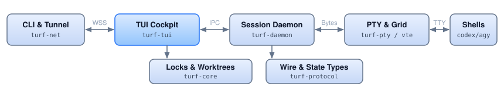
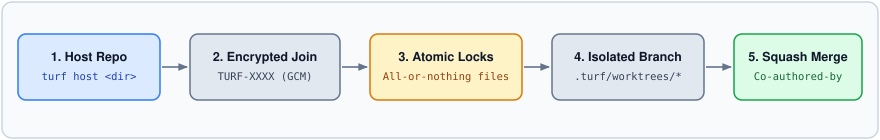

# Turf — System Architecture

This document outlines the technical architecture, crate layout, concurrency model, and UI invariants for **Turf**. Recorded decisions and worker invariants live in [docs/ADR.md](./ADR.md).

## 1. Problem & Topology

Single-terminal tools and AI coding CLIs break down when multiple humans or agents edit the same repository simultaneously. Turf coordinates parallel work through a host-peer workspace architecture:

- The **Host Machine** ([turf-net](./../crates/turf-net), [turf-daemon](./../crates/turf-daemon), [turf-core](./../crates/turf-core)) owns the repository on disk, persistent PTY shells, Intent Board state, atomic file locks, and isolated `.turf/worktrees/*` checkouts.
- **Collaborating Peers** ([turf-tui](./../crates/turf-tui), `TunnelClient`) authenticate via a room code (`TURF-XXXX`) using SHA-256 key derivation and AES-256-GCM encrypted handshakes—syncing tasks, locks, and terminal streams without persisting credentials to `.turf/session.json` or logs.

## 2. Workspace Layout

### Rust Crates ([crates/](./../crates))

| Crate | Responsibility |
| :--- | :--- |
| [turf-pty](./../crates/turf-pty) | Cross-platform PTY allocation via `portable-pty` (POSIX PTY / Windows ConPTY), non-blocking Tokio streaming, and foreground process inspection (`/proc` + `tcgetpgrp`). |
| [turf-vte](./../crates/turf-vte) | 2D `ScreenBuffer`, ANSI/TrueColor parser via `vte`, DEC alternate screen isolation (`?1049h`/`?1049l`), OSC 8 hyperlinks, wide-glyph continuation cells, and a 10,000-line scrollback buffer. |
| [turf-protocol](./../crates/turf-protocol) | Contracts for Intent Board tasks (`TaskCard`, `TaskStatus`), `FileLock`, `CoAuthor` trailers, and length-prefixed JSON-RPC daemon IPC (`DaemonRequest`, `DaemonResponse`, `DaemonEvent`). |
| [turf-core](./../crates/turf-core) | Atomic fail-fast `LockManager` (heartbeat TTL & PID liveness checks), `RwLock`-backed `IntentBoard` atomic disk persistence, and `WorktreeManager`. |
| [turf-daemon](./../crates/turf-daemon) | Persistent background server (`TurfDaemonServer`) over Unix domain socket / Windows named pipe with 4-byte length-prefixed framing, process polling, and parent `cwd` inheritance on splits. |
| [turf-tui](./../crates/turf-tui) | Ratatui + Crossterm spatial cockpit (`TerminalCockpit`) with full-height split panes, 60fps zero-allocation VTE blitting, scrollable tabs, tab context menu, pane-bounded copy, and clickable URLs. |
| [turf-net](./../crates/turf-net) | AES-256-GCM WebSocket tunnel (`TunnelServer`, `TunnelClient`), state delta replication, and `turf` CLI binary (`cli.rs`). |

### Node.js ESM Prototype ([bin/](./../bin), [src/](./../src), [test/](./../test))

The repository retains the initial Node.js ESM implementation (`cli.js`, `cockpit.js`, `intent-board.js`, `lock-manager.js`, `worktree-manager.js`, `agent-runner.js`, `tunnel.js`, `diff-viewer.js`), verified with `node --test`. See [AGENTS.md](./../AGENTS.md) and [ROADMAP.md](./../ROADMAP.md) for features still being ported to Rust.

## 3. Concurrency & Safety Model

1. Tasks declare their target file list upfront on the Intent Board (`[MD-040]`).
2. `LockManager` acquires all declared locks atomically—any conflict fails fast with zero partial locks acquired (`[MD-002]`, `[MD-007]`, `[MD-023]`). Heartbeat TTLs and PID binding clean up stale locks after crashes; hosts keep an explicit `force_unlock` override.
3. Each task runs inside an isolated `.turf/worktrees/<task-id>` checkout and squash-merges back into the target branch with `Co-authored-by` trailers (`[MD-022]`, `[MD-033]`).

## 4. Persistent Daemon & UI Ergonomics

Closing the terminal window or detaching (`F4` / `Alt+D`) leaves running shells, editors, and AI CLIs alive inside [turf-daemon](./../crates/turf-daemon), ready to re-attach via `turf` or `turf attach [session]`. When background sockets are restricted (such as headless CI), `TerminalCockpit` falls back to standalone in-process PTY or headless modes.

- Top row displays a full-width scrollable tab strip with `<` / `>` overflow arrows, pinned `+` modal trigger, click/right-click tab menu (`New tab`, `Rename`, `Close`), and right-aligned session badge (`● TURF-XXXX • HOST`).
- Left sidebar (~22%) separates `spaces`, `intents & tasks`, `active locks`, `peers`, and `? help «` with single-line dividers (`│`, `─`).
- Terminal panes span full height down to the bottom edge using native transparency (`Color::Reset`), non-conflicting `Alt+...` / `F1`–`F4` shortcuts, pane-bounded mouse copy (`OSC 52` / `clip.exe`), and clickable OSC 8 / wrapped URLs.
